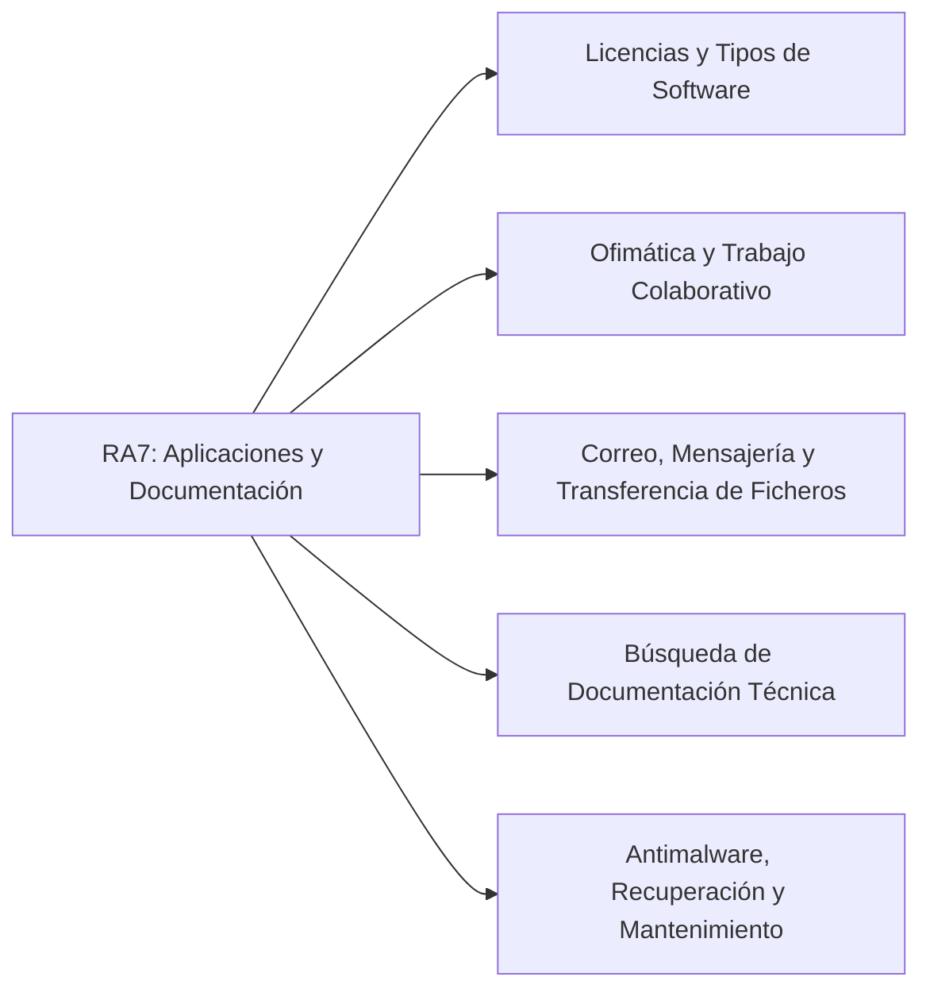

# RA7 · Elabora documentación valorando y utilizando aplicaciones informáticas de propósito general

> **Estado del bloque:** Planificado (comienza tras completar y validar RA6).

---

## Mapa Conceptual del Bloque

---

## Criterios de Evaluación Oficiales

| Código | Criterio de Evaluación | Cobertura |
| :---: | :--- | :---: |
| **RA7.a** | Se ha clasificado software en función de su licencia y propósito. | Pendiente |
| **RA7.b** | Se han analizado las necesidades específicas de software asociadas al uso de sistemas informáticos en diferentes entornos productivos. | Pendiente |
| **RA7.c** | Se han realizado tareas de documentación mediante el uso de herramientas ofimáticas y de trabajo colaborativo. | Pendiente |
| **RA7.d** | Se han utilizado sistemas de correo y mensajería electrónica. | Pendiente |
| **RA7.e** | Se han utilizado los servicios de transferencia de ficheros. | Pendiente |
| **RA7.f** | Se han utilizado métodos de búsqueda de documentación técnica mediante el uso de servicios de Internet. | Pendiente |
| **RA7.g** | Se han utilizado herramientas de propósito general. | Pendiente |

---

## Contenidos Básicos Asociados (*Explotación de aplicaciones informáticas de propósito general*)

- Software: tipos, requisitos, licencias.
- Herramientas ofimáticas y de trabajo colaborativo.
- Utilidades de propósito general: antimalware, correo, transferencia de ficheros, recuperación de datos, mantenimiento del sistema, entre otros.

---

## Conceptos Teóricos

*Bloque planificado tras RA6. Consulta el [índice general de conceptos](../conceptos/index.md).*

## Ejercicios Prácticos Resueltos

*Bloque planificado tras RA6. Consulta el [índice de ejercicios](../ejercicios/index.md).*

## Prácticas Integradoras de Aula

*Bloque planificado tras RA6. Consulta el [índice de prácticas](../practicas/index.md).*
