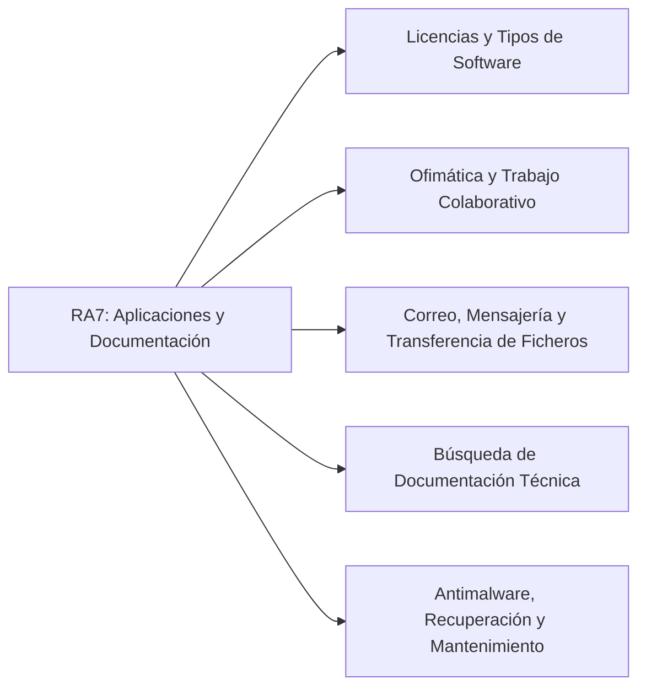

# RA7 · Elabora documentación valorando y utilizando aplicaciones informáticas de propósito general

> **Estado del bloque:** Completado ✅ (6 conceptos teóricos, 5 diagramas SVG, 5 ejercicios resueltos `e31`–`e35`, [práctica integradora `p07`](../practicas/p07-ra7-documentacion-markdown-correo-transferencia-utilidades-enunciado.md) y banco de evaluación privado).

---

## Mapa Conceptual del Bloque

---

## Criterios de Evaluación Oficiales

| Código | Criterio de Evaluación | Cobertura |
| :---: | :--- | :---: |
| **RA7.a** | Se ha clasificado software en función de su licencia y propósito. | [Concepto](../conceptos/ra7-clasificacion-software-licencias-modelos-distribucion.md) · [e31](../ejercicios/e31-ra7-auditoria-licencias-seleccion-software-empresa.md) · [p07](../practicas/p07-ra7-documentacion-markdown-correo-transferencia-utilidades-enunciado.md) |
| **RA7.b** | Se han analizado las necesidades específicas de software asociadas al uso de sistemas informáticos en diferentes entornos productivos. | [Concepto](../conceptos/ra7-analisis-necesidades-software-entornos-productivos.md) · [e31](../ejercicios/e31-ra7-auditoria-licencias-seleccion-software-empresa.md) · [p07](../practicas/p07-ra7-documentacion-markdown-correo-transferencia-utilidades-enunciado.md) |
| **RA7.c** | Se han realizado tareas de documentación mediante el uso de herramientas ofimáticas y de trabajo colaborativo. | [Concepto](../conceptos/ra7-documentacion-ofimatica-markdown-trabajo-colaborativo.md) · [e32](../ejercicios/e32-ra7-documentacion-tecnica-markdown-pandoc-git.md) · [p07](../practicas/p07-ra7-documentacion-markdown-correo-transferencia-utilidades-enunciado.md) |
| **RA7.d** | Se han utilizado sistemas de correo y mensajería electrónica. | [Concepto](../conceptos/ra7-sistemas-correo-mensajeria-corporativa-segura.md) · [e33](../ejercicios/e33-ra7-configuracion-cliente-correo-spf-dkim-dmarc.md) · [p07](../practicas/p07-ra7-documentacion-markdown-correo-transferencia-utilidades-enunciado.md) |
| **RA7.e** | Se han utilizado los servicios de transferencia de ficheros. | [Concepto](../conceptos/ra7-servicios-transferencia-ficheros-sftp-scp-sincronizacion.md) · [e34](../ejercicios/e34-ra7-transferencia-segura-sftp-rsync-hashes-sha256.md) · [p07](../practicas/p07-ra7-documentacion-markdown-correo-transferencia-utilidades-enunciado.md) |
| **RA7.f** | Se han utilizado métodos de búsqueda de documentación técnica mediante el uso de servicios de Internet. | [Concepto](../conceptos/ra7-busqueda-documentacion-tecnica-utilidades-sistema.md) · [e32](../ejercicios/e32-ra7-documentacion-tecnica-markdown-pandoc-git.md) · [e35](../ejercicios/e35-ra7-utilidades-compresion-clamav-mantenimiento.md) · [p07](../practicas/p07-ra7-documentacion-markdown-correo-transferencia-utilidades-enunciado.md) |
| **RA7.g** | Se han utilizado herramientas de propósito general. | [Concepto](../conceptos/ra7-busqueda-documentacion-tecnica-utilidades-sistema.md) · [e35](../ejercicios/e35-ra7-utilidades-compresion-clamav-mantenimiento.md) · [p07](../practicas/p07-ra7-documentacion-markdown-correo-transferencia-utilidades-enunciado.md) |

---

## Contenidos Básicos Asociados (*Explotación de aplicaciones informáticas de propósito general*)

- Software: tipos, requisitos, licencias.
- Herramientas ofimáticas y de trabajo colaborativo.
- Utilidades de propósito general: antimalware, correo, transferencia de ficheros, recuperación de datos, mantenimiento del sistema, entre otros.

---

## Conceptos Teóricos

1. [Clasificación del Software, Licencias y Modelos de Distribución](../conceptos/ra7-clasificacion-software-licencias-modelos-distribucion.md) (`RA7.a`)
2. [Análisis de Necesidades de Software en Entornos Productivos](../conceptos/ra7-analisis-necesidades-software-entornos-productivos.md) (`RA7.b`)
3. [Documentación Técnica, Ofimática, Markdown y Trabajo Colaborativo](../conceptos/ra7-documentacion-ofimatica-markdown-trabajo-colaborativo.md) (`RA7.c`)
4. [Sistemas de Correo Electrónico y Mensajería Corporativa Segura](../conceptos/ra7-sistemas-correo-mensajeria-corporativa-segura.md) (`RA7.d`)
5. [Servicios de Transferencia Segura de Ficheros (SFTP, SCP y Sincronización)](../conceptos/ra7-servicios-transferencia-ficheros-sftp-scp-sincronizacion.md) (`RA7.e`)
6. [Búsqueda de Documentación Técnica y Utilidades de Propósito General](../conceptos/ra7-busqueda-documentacion-tecnica-utilidades-sistema.md) (`RA7.f`, `RA7.g`)

## Ejercicios Prácticos Resueltos

1. [e31 · Auditoría de Licencias y Selección de Software en Empresa](../ejercicios/e31-ra7-auditoria-licencias-seleccion-software-empresa.md) (`RA7.a`, `RA7.b` · 3 GB RAM)
2. [e32 · Documentación Técnica con Markdown, Pandoc y Git](../ejercicios/e32-ra7-documentacion-tecnica-markdown-pandoc-git.md) (`RA7.c`, `RA7.f` · 2 GB RAM)
3. [e33 · Configuración de Cliente de Correo y Validación SPF, DKIM y DMARC](../ejercicios/e33-ra7-configuracion-cliente-correo-spf-dkim-dmarc.md) (`RA7.d` · 2 GB RAM)
4. [e34 · Transferencia Segura con SFTP, `rsync` y Verificación SHA-256](../ejercicios/e34-ra7-transferencia-segura-sftp-rsync-hashes-sha256.md) (`RA7.e` · 6 GB RAM)
5. [e35 · Utilidades de Compresión, Análisis ClamAV y Mantenimiento del Sistema](../ejercicios/e35-ra7-utilidades-compresion-clamav-mantenimiento.md) (`RA7.f`, `RA7.g` · 6 GB RAM)

## Prácticas Integradoras de Aula

- **[p07 · Documentación Markdown, Correo Seguro, Transferencia SFTP y Utilidades Corporativas](../practicas/p07-ra7-documentacion-markdown-correo-transferencia-utilidades-enunciado.md)** (`RA7.a`–`RA7.g` · `DAM-Doc-Ubuntu` 2 GB + `DAM-Oficina-Win10` 4 GB = **6 GB RAM**) — *Solución docente reservada en fichero privado (`publicar: false`).*
